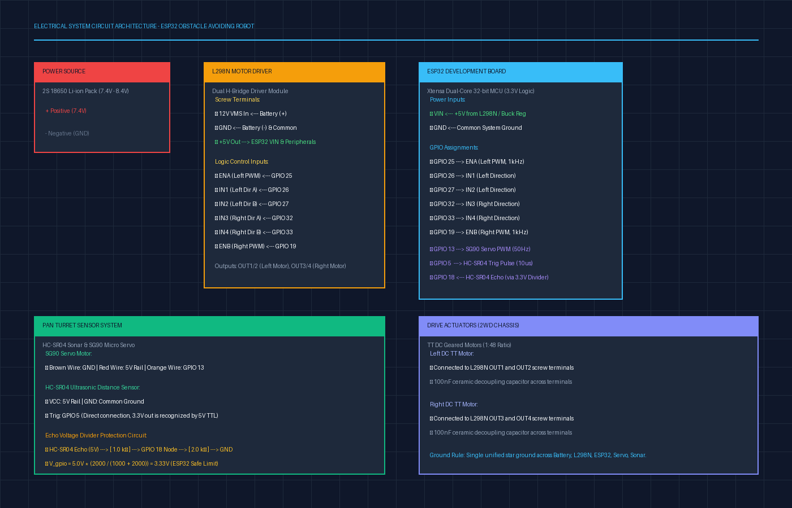
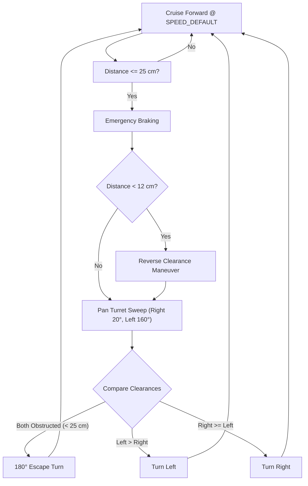
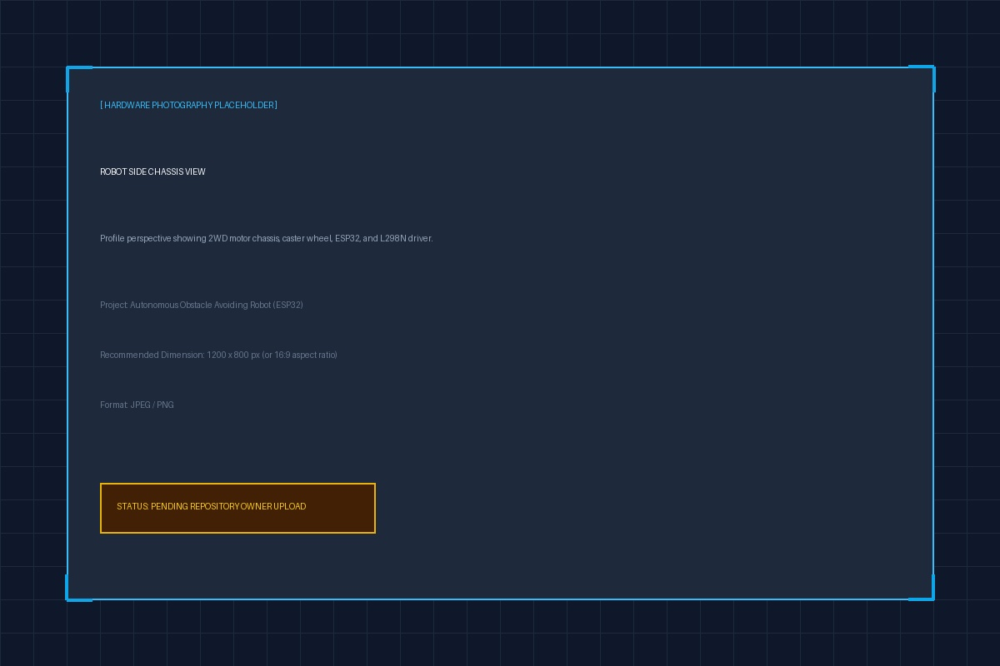
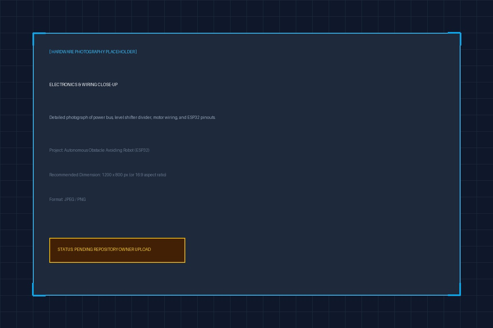

# Autonomous Obstacle Avoiding Robot

[](LICENSE)
[](https://www.espressif.com/en/products/socs/esp32)
[](https://github.com/espressif/arduino-esp32)
[](firmware/)
[]()

An autonomous mobile robotic car powered by the **ESP32** microcontroller. The system perceives obstacles in real time using an ultrasonic distance sensor mounted on an active servo panning turret, arbitrates spatial clearance across lateral quadrants, and navigates environments dynamically without human intervention or collision.

Designed with engineering rigor, modular C++ firmware, hardware voltage level-shifting, and anti-oscillation recovery algorithms.

---

## Table of Contents

1. [Project Overview](#project-overview)
2. [Key Engineering Features](#key-engineering-features)
3. [System Architecture](#system-architecture)
4. [Hardware Requirements](#hardware-requirements)
5. [Pin Connection Specification](#pin-connection-specification)
6. [Circuit Architecture & Level Shifting](#circuit-architecture--level-shifting)
7. [Repository Structure](#repository-structure)
8. [Software Requirements & Dependencies](#software-requirements--dependencies)
9. [Firmware Setup & Flashing](#firmware-setup--flashing)
10. [Autonomous Decision Algorithm](#autonomous-decision-algorithm)
11. [Hardware Assembly Guide](#hardware-assembly-guide)
12. [Troubleshooting & Diagnostics](#troubleshooting--diagnostics)
13. [Project Demonstration](#project-demonstration)
14. [Future Roadmap](#future-roadmap)
15. [Contributing](#contributing)
16. [License](#license)

---

## Project Overview

Mobile robots operating in unknown indoor environments require robust, deterministic perception and low-latency motor actuation. This project implements a fully self-contained reactive robotics platform utilizing:

* **Microcontroller:** Dual-core 32-bit ESP32 (Xtensa LX6) operating at 240 MHz.
* **Perception:** HC-SR04 ultrasonic distance sensor with 3-sample median noise filtering.
* **Active Turret:** SG90 micro-servo panning mechanism providing a $140^\circ$ spatial perception sweep ($20^\circ$ to $160^\circ$).
* **Actuation:** L298N Dual H-Bridge motor driver driving two geared DC motors via hardware pulse-width modulation (LEDC PWM).
* **Navigation Logic:** Finite State Machine (FSM) with emergency reverse recovery, lateral spatial arbitration, and corner oscillation deadlock breaking.

---

## Key Engineering Features

* **Autonomous Navigation:** Continuous non-blocking distance sampling with deterministic braking upon obstacle detection ($d \le 25\text{ cm}$).
* **Active Pan Scanning:** Evaluates left and right spatial corridors via an automated servo sweep before selecting the optimal path.
* **Critical Collision Recovery:** Automatically reverses if an obstacle appears inside the critical turning clearance ($d < 12\text{ cm}$).
* **Deadlock / Oscillation Breaker:** Tracks consecutive turns to detect corner entrapment and executes a 180° escape maneuver when trapped.
* **Hardware Signal Safety:** Incorporates an external resistive voltage divider ($1\,\text{k}\Omega / 2\,\text{k}\Omega$) on the HC-SR04 Echo output, shifting the 5V signal safely to 3.33V for the ESP32.
* **ESP32 Core Compatibility:** Supports both ESP32 Arduino Core 2.x (channel-based LEDC) and Core 3.x (pin-based LEDC).
* **Modular Codebase:** Decoupled hardware configuration ([`config.h`](firmware/config.h)), motor driver abstraction ([`motor_control.h`](firmware/motor_control.h)), and navigation logic ([`obstacle_avoiding_robot.ino`](firmware/obstacle_avoiding_robot.ino)).

---

## System Architecture

The robot processes sensory feedback through a closed perception-actuation loop:

```mermaid
flowchart TD
    subgraph PERCEPTION["Perception Subsystem"]
        US["HC-SR04 Sonar Transducer"] --> |5V Echo Pulse| VDIV["Resistive Voltage Divider\n(1kΩ / 2kΩ)"]
        VDIV --> |3.33V Logic| MCU_IN["ESP32 GPIO 18 (Echo)"]
        MCU_OUT_T["ESP32 GPIO 5 (Trig)"] --> |10µs Pulse| US
        SERVO["SG90 Pan Servo"] <-- |50Hz PWM / GPIO 13| MCU_OUT_S["ESP32 PWM"]
    end

    subgraph BRAIN["Decision Engine (ESP32)"]
        MCU_IN --> FILTER["3-Point Median Noise Filter"]
        FILTER --> FSM{"Autonomous State Machine\n- Forward Cruising\n- Safety Stop (<= 25 cm)\n- Critical Reverse (< 12 cm)\n- Flank Scanning (20° / 160°)\n- Loop Breaker Override"}
    end

    subgraph ACTUATION["Actuation Subsystem"]
        FSM --> |LEDC PWM (1 kHz)| DRIVER["L298N Dual H-Bridge Driver"]
        DRIVER --> MOTOR_L["Left TT DC Gear Motor"]
        DRIVER --> MOTOR_R["Right TT DC Gear Motor"]
    end

    subgraph POWER["Power Distribution"]
        BAT["2S Li-ion Battery (7.4V - 8.4V)"] --> |Motor Supply| DRIVER
        DRIVER --> |Regulated 5V Rail| MCU_PWR["ESP32 VIN"]
        DRIVER --> |Regulated 5V Rail| SERVO
        DRIVER --> |Regulated 5V Rail| US
    end
```

---

## Hardware Requirements

| Component | Quantity | Key Specification | Link / Details |
| :--- | :---: | :--- | :--- |
| **ESP32 Dev Module** | 1 | NodeMCU-32S / ESP32-WROOM-32 (30 or 38 pins) | [Details](hardware/components.md#21-microcontroller-esp32-dev-module) |
| **L298N Motor Driver** | 1 | Dual full-bridge driver with onboard 5V regulator | [Details](hardware/components.md#22-motor-driver-l298n-dual-h-bridge) |
| **HC-SR04 Ultrasonic Sensor** | 1 | $40\,\text{kHz}$ sonar, 2 cm to 400 cm range | [Details](hardware/components.md#23-ultrasonic-sensor-hc-sr04) |
| **SG90 Micro Servo** | 1 | $180^\circ$ rotation, 1.8 kg·cm torque | [Details](hardware/components.md#24-pan-turret-servo-sg90-micro-servo) |
| **DC Geared Motors** | 2 | 1:48 reduction TT motors with rubber wheels | [Details](hardware/components.md#1-bill-of-materials-bom) |
| **2WD Robot Chassis** | 1 | Baseplate with front omni/caster ball wheel | [Details](hardware/components.md#1-bill-of-materials-bom) |
| **Battery Pack** | 1 | 2S 18650 Li-ion holder (7.4V nom., 8.4V max) | [Details](hardware/components.md#3-power-architecture--battery-selection) |
| **Resistors (Voltage Divider)** | 2 | $1.0\,\text{k}\Omega$ ($R_1$) and $2.0\,\text{k}\Omega$ ($R_2$) (or $2.2\,\text{k}\Omega$) | [Details](hardware/pin_connections.md#3-hc-sr04-echo-level-shifter-voltage-divider) |
| **Master Power Switch** | 1 | SPST rocker or toggle switch ($\ge 3\text{A}$) | [Details](hardware/wiring_diagram.md#step-1-power-subsystem--l298n-terminal-block) |
| **Wiring & Jumpers** | 1 kit | Male-to-Female, Female-to-Female jumpers | [Details](hardware/wiring_diagram.md) |

For complete technical specifications, consult [hardware/components.md](hardware/components.md).

---

## Pin Connection Specification

The pinout is engineered to avoid ESP32 strapping pins (`GPIO 0, 2, 12, 15`) and input-only pins (`GPIO 34-39`):

| Device | Device Pin | ESP32 GPIO | Signal Mode | Notes |
| :--- | :--- | :--- | :--- | :--- |
| **L298N Motor Driver** | `ENA` | `GPIO 25` | Output (PWM) | Left motor speed control |
| | `IN1` | `GPIO 26` | Output (Digital) | Left motor direction 1 |
| | `IN2` | `GPIO 27` | Output (Digital) | Left motor direction 2 |
| | `IN3` | `GPIO 32` | Output (Digital) | Right motor direction 1 |
| | `IN4` | `GPIO 33` | Output (Digital) | Right motor direction 2 |
| | `ENB` | `GPIO 19` | Output (PWM) | Right motor speed control |
| | `GND` | `GND` | Reference | Common ground reference |
| **HC-SR04 Ultrasonic** | `VCC` | `5V Rail` | Power Input | From L298N 5V output |
| | `Trig` | `GPIO 5` | Output (Digital) | $10\,\mu\text{s}$ trigger pulse |
| | `Echo` | `GPIO 18` | Input (Digital) | **Via 1kΩ / 2kΩ voltage divider** |
| | `GND` | `GND` | Reference | Common ground reference |
| **SG90 Micro Servo** | `PWM` (Orange) | `GPIO 13` | Output (PWM) | 50 Hz servo position signal |
| | `VCC` (Red) | `5V Rail` | Power Input | From L298N 5V output |
| | `GND` (Brown) | `GND` | Reference | Common ground reference |
| **Power Input** | `VIN` | `5V Rail` | Power Input | Powers ESP32 3.3V LDO |
| | `GND` | `GND` | Reference | Common system ground |

Detailed pin justifications and electrical constraints are documented in [hardware/pin_connections.md](hardware/pin_connections.md).

---

## Circuit Architecture & Level Shifting



### HC-SR04 Echo Level Shifter Calculation
The HC-SR04 operates at 5V and outputs a 5V logic signal on the Echo line. Connecting 5V directly to the ESP32 GPIO violates the maximum input voltage rating ($V_{DD} + 0.3\text{V} \approx 3.6\text{V}$). A resistive voltage divider safely scales the voltage:

$$V_{\text{out}} = V_{\text{in}} \times \left( \frac{R_2}{R_1 + R_2} \right) = 5.0\text{V} \times \left( \frac{2000\,\Omega}{1000\,\Omega + 2000\,\Omega} \right) = 3.333\text{V}$$

* $3.333\text{V}$ is safely below the ESP32 $3.6\text{V}$ absolute maximum and well above the $2.475\text{V}$ ($0.75 \times V_{DD}$) high-level input threshold ($V_{IH}$).

Refer to [hardware/wiring_diagram.md](hardware/wiring_diagram.md) for step-by-step assembly diagrams.

---

## Repository Structure

```
obstacle-avoiding-robot/
├── .gitignore                          # Git ignore definitions for Arduino/ESP32/OS
├── LICENSE                             # MIT Open-Source License
├── README.md                           # Main engineering documentation
│
├── firmware/                           # Embedded C++ firmware
│   ├── config.h                        # Pinouts, speed presets, angles, and thresholds
│   ├── motor_control.h                 # Modular L298N motor driver class
│   └── obstacle_avoiding_robot.ino     # State machine and autonomous control loop
│
├── hardware/                           # Hardware schematics & wiring specifications
│   ├── components.md                   # Bill of Materials and component analysis
│   ├── pin_connections.md              # Pin mapping, GPIO selection rules, level shifter
│   ├── wiring_diagram.md               # Step-by-step wiring instructions & EMI rules
│   └── circuit_diagram.png             # Visual electrical architecture diagram
│
├── documentation/                      # In-depth technical documentation
│   ├── working_principle.md            # Physics of ultrasound, H-bridge mechanics, kinematics
│   ├── algorithm.md                    # State machine flowchart, noise filtering, deadlock logic
│   ├── troubleshooting.md              # Multimeter diagnostic tests and symptom matrix
│   └── future_improvements.md          # ROS 2, LiDAR, ToF, and PID encoder roadmap
│
└── images/                             # Hardware documentation photography
    ├── robot_front.jpg                 # Front elevation photograph placeholder
    ├── robot_side.jpg                  # Profile chassis layout placeholder
    └── circuit.jpg                     # Close-up electronics & wiring placeholder
```

---

## Software Requirements & Dependencies

* **Development Environment:** [Arduino IDE](https://www.arduino.cc/en/software) (version 2.0.0 or later) or [PlatformIO](https://platformio.org/).
* **Board Core:** [Arduino-ESP32 Board Support Package](https://github.com/espressif/arduino-esp32) (Core v2.0.4 or v3.x+).
* **Required Libraries:**
  * `ESP32Servo` by Kevin Harrington (Available via Arduino Library Manager).
  * Standard Arduino C++ runtime (`Arduino.h`).

---

## Firmware Setup & Flashing

### Step 1: Install ESP32 Board Package
1. In Arduino IDE, navigate to **File** $\rightarrow$ **Preferences**.
2. Add the following URL to **Additional Boards Manager URLs**:
   ```
   https://raw.githubusercontent.com/espressif/arduino-esp32/gh-pages/package_esp32_index.json
   ```
3. Open **Tools** $\rightarrow$ **Board** $\rightarrow$ **Boards Manager**, search for `esp32` by Espressif Systems, and click **Install**.

### Step 2: Install ESP32Servo Library
1. Open **Sketch** $\rightarrow$ **Include Library** $\rightarrow$ **Manage Libraries...**
2. Search for `ESP32Servo`.
3. Select the latest version and click **Install**.

### Step 3: Open and Configure Project
1. Open [`firmware/obstacle_avoiding_robot.ino`](firmware/obstacle_avoiding_robot.ino) in Arduino IDE.
2. Select your board: **Tools** $\rightarrow$ **Board** $\rightarrow$ **ESP32 Arduino** $\rightarrow$ **ESP32 Dev Module**.
3. Configure the following board parameters:
   * **Upload Speed:** `921600` (or `115200` if upload is unstable)
   * **CPU Frequency:** `240MHz (WiFi/BT)`
   * **Flash Frequency:** `80MHz`
   * **Flash Mode:** `QIO`
   * **Flash Size:** `4MB (32Mb)`
   * **Port:** Select the matching serial port (e.g., `/dev/cu.usbserial-*` or `COMx`).

### Step 4: Flash Firmware
1. Click **Upload** ($\rightarrow$).
2. *Note:* If the IDE stalls at `Connecting......._____`, press and hold the **BOOT** button on the ESP32 until the flashing progress bar begins.
3. Open the **Serial Monitor** at `115200` baud to observe system telemetry.

---

## Autonomous Decision Algorithm

The robot continuously monitors obstacle distance using high-speed Time-of-Flight ultrasound:

```
Distance (cm) = (Duration (µs) × 0.0343 cm/µs) / 2 = Duration / 58.3
```



For the complete state transition table, median filtering implementation, and loop-breaker math, see [documentation/algorithm.md](documentation/algorithm.md).

---

## Hardware Assembly Guide

1. **Chassis & Motors:** Secure the two TT gear motors to the lower acrylic chassis using the included M3 machine screws and acrylic brackets. Attach the rubber drive wheels to the output shafts.
2. **Caster Wheel:** Fasten the front omni-directional caster / ball wheel with standoffs to ensure the chassis remains parallel to the ground.
3. **Driver & Microcontroller:** Mount the L298N driver towards the rear (close to motors) and the ESP32 module on anti-vibration nylon standoffs in the center.
4. **Sensor Turret:** Fasten the SG90 servo motor facing forward at the center front edge of the chassis. Mount the HC-SR04 sensor bracket onto the servo horn.
5. **Electrical Harnessing:** Connect the power bus, motor terminals, and signal jumpers strictly according to [hardware/wiring_diagram.md](hardware/wiring_diagram.md).

---

## Troubleshooting & Diagnostics

| Symptom | Probable Cause | Action |
| :--- | :--- | :--- |
| **ESP32 brownouts / reboots** | Servo or motor current spikes dipping 5V rail | Add $470\,\mu\text{F}$ capacitor across 5V rail; verify common ground. |
| **Ultrasonic sensor reads 0 or 300 cm** | Missing common ground or inverted Trig/Echo | Verify common GND; check Echo voltage divider wiring. |
| **Motors spin in reverse** | Reversed DC motor polarity at terminals | Swap motor wire leads at L298N `OUT1`/`OUT2` or `OUT3`/`OUT4`. |
| **Robot oscillates in corners** | Ultrasonic reflections in tight corners | Built-in Loop Breaker triggers after 3 consecutive turns; see [algorithm.md](documentation/algorithm.md). |

For comprehensive diagnostic procedures, see [documentation/troubleshooting.md](documentation/troubleshooting.md).

---

## Project Demonstration

| Front Elevation | Side Profile | Electronics & Wiring |
| :---: | :---: | :---: |
|  |  |  |
| *Active ultrasonic turret alignment* | *Differential 2WD chassis layout* | *L298N, ESP32, and level shifter* |

---

## Future Roadmap

* **Time-of-Flight Perception:** Integrating VL53L1X laser ToF sensors for non-acoustic, millimetric distance profiling.
* **Closed-Loop Odometry:** Adding optical wheel encoders with PID control for precise straight-line trajectory tracking.
* **FreeRTOS Concurrency:** Segregating sensor acquisition (Core 0) and wireless telemetry (Core 1).
* **Wireless Dashboard:** Real-time WebSockets radar sweep telemetry hosted on the ESP32.
* **ROS 2 Integration:** micro-ROS implementation for SLAM and Nav2 navigation.

For full technical proposals and architectures, see [documentation/future_improvements.md](documentation/future_improvements.md).

---

## Contributing

Contributions, bug reports, and hardware improvements are welcome. Please adhere to the following workflow:

1. Fork the repository.
2. Create a feature branch (`git checkout -b feature/enhanced-sensing`).
3. Commit your changes with descriptive commit messages (`git commit -m 'feat: add VL53L0X I2C support'`).
4. Push to the branch (`git push origin feature/enhanced-sensing`).
5. Open a Pull Request detailing the hardware changes and verification tests performed.

---

## License

This project is licensed under the **MIT License** - see the [LICENSE](LICENSE) file for complete details.

