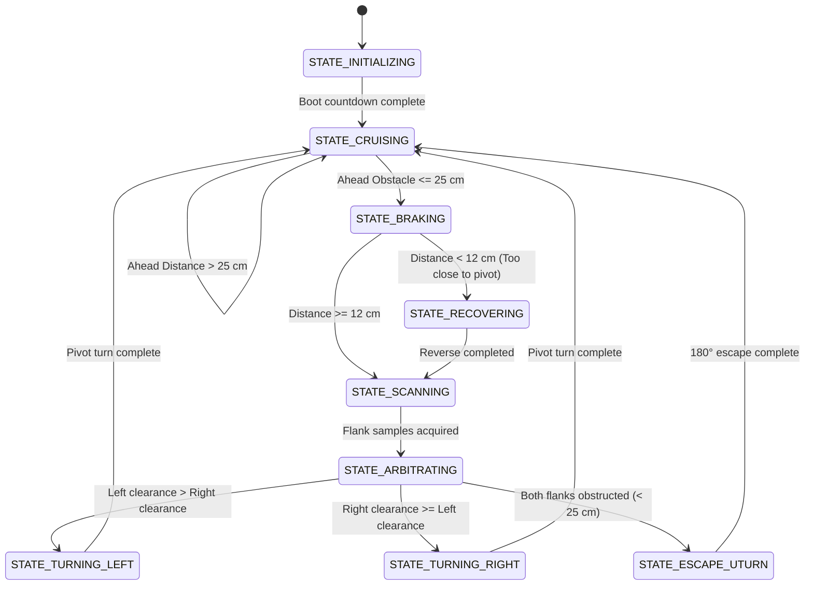

# Autonomous Navigation Algorithm & State Machine

This document details the navigation logic, state machine architecture, sensor filtering techniques, and deadlock prevention algorithms implemented in the robot's firmware.

---

## 1. High-Level Navigation Flowchart

```mermaid
flowchart TD
    START([System Power-On & Initialization]) --> SETUP[Configure GPIOs, LEDC PWM, Centering Turret]
    SETUP --> DELAY_START[2-Second Safety Placement Delay]
    DELAY_START --> CRUISE[Forward Cruising @ SPEED_DEFAULT]

    CRUISE --> READ_DIST[Sample Ultrasonic Distance\ngetFilteredDistance]
    READ_DIST --> CHECK_OBS{Distance <= 25 cm?}
    
    CHECK_OBS -- No --> CRUISE
    CHECK_OBS -- Yes --> STOP[Emergency Motor Braking]

    STOP --> CHECK_CRIT{Distance < 12 cm?}
    CHECK_CRIT -- Yes --> REVERSE[Reverse Backwards\nDURATION_BACKWARD_MS]
    REVERSE --> SCAN
    CHECK_CRIT -- No --> SCAN[Servo Spatial Clearance Scan\nRight: 20° | Left: 160°]

    SCAN --> ARBITRATE{Evaluate Flank Clearance}

    ARBITRATE -- Both < 25 cm --> UTURN[Cul-de-sac Detected:\nExecute 180° Escape Turn]
    ARBITRATE -- Left > Right --> CHECK_LEFT_LOOP{Consecutive Lefts >= 3?}
    ARBITRATE -- Right >= Left --> CHECK_RIGHT_LOOP{Consecutive Rights >= 3?}

    CHECK_LEFT_LOOP -- Yes --> FORCE_UTURN_L[Force 180° Loop-Breaker Turn]
    CHECK_LEFT_LOOP -- No --> TURN_LEFT[Pivot Turn Left\nDURATION_TURN_MS]

    CHECK_RIGHT_LOOP -- Yes --> FORCE_UTURN_R[Force 180° Loop-Breaker Turn]
    CHECK_RIGHT_LOOP -- No --> TURN_RIGHT[Pivot Turn Right\nDURATION_TURN_MS]

    TURN_LEFT --> STABILIZE[Post-Turn Motor Settle Delay]
    TURN_RIGHT --> STABILIZE
    UTURN --> STABILIZE
    FORCE_UTURN_L --> STABILIZE
    FORCE_UTURN_R --> STABILIZE

    STABILIZE --> CRUISE
```

---

## 2. Finite State Machine (FSM)

The autonomous navigator operates as a deterministic Finite State Machine (FSM):



---

## 3. Sensor Signal Processing & Glitch Rejection

Ultrasonic distance readings are subject to physical environmental noise:
* **Specular Reflection:** At shallow angles (> 45° incident angle), sound bounces away from the sensor without returning, resulting in an erroneous timeout ($300\text{ cm}$).
* **Multi-path Interference:** Acoustic echoes bouncing between adjacent obstacles can register as false early reflections.
* **Acoustic Jitter:** Minor thermal air currents cause variation in pulse widths.

### Median Filtering Algorithm
To eliminate outliers without the phase lag of a moving average filter, the firmware acquires $N = 3$ consecutive samples separated by an acoustic dissipation delay ($3\text{ ms}$):

$$\vec{S} = [s_0, s_1, s_2]$$

The samples are sorted in ascending order via an optimal 3-element sorting network:
$$\text{Sorted}(\vec{S}) = [s_{\text{min}}, s_{\text{median}}, s_{\text{max}}]$$

The output distance is chosen as:
$$d_{\text{filtered}} = s_{\text{median}}$$

If an acoustic spike produces a transient zero ($0\text{ cm}$) or false timeout ($300\text{ cm}$), the median filter discards the aberration entirely, providing a clean distance signal to the state machine.

---

## 4. Deadlock & Oscillation Prevention (Loop Breaker)

A common failure mode in purely reactive mobile robots is **symmetric oscillation trap** (e.g., getting stuck inside a narrow box or corner corridor):
1. The robot faces a wall and turns left.
2. It immediately detects the adjacent wall and turns right.
3. It detects the initial wall and turns left again, oscillating endlessly between the two headings.

### Algorithmic Solution
The firmware tracks the direction of consecutive pivot turns:
* If the robot chooses the same direction (e.g., `LEFT`) $3$ times consecutively without entering an extended forward cruise phase, the variable `consecutiveTurnCount` exceeds `MAX_CONSECUTIVE_TURNS` ($3$).
* The arbitration logic intervenes and overrides the decision, commanding a full **180° escape turn** (`DURATION_U_TURN_MS`).
* This breaks the geometric symmetry of the corner and allows the robot to exit the deadlock enclosure.

---

## 5. Threshold Configuration Matrix

| Parameter Constant | Value | Purpose | Tuning Notes |
| :--- | :---: | :--- | :--- |
| `OBSTACLE_STOP_DISTANCE_CM` | `25.0 cm` | Primary safety stopping boundary | Increase for faster cruise speeds; decrease for tight labyrinths |
| `OBSTACLE_CRITICAL_DISTANCE_CM`| `12.0 cm` | Reverse clearance trigger | Prevents chassis corners from scraping obstacle during pivot |
| `SERVO_ANGLE_CENTER` | `90°` | Forward-looking turret heading | Calibrate mechanically when seating the horn on the servo spline |
| `SERVO_ANGLE_RIGHT` | `20°` | Right quadrant profiling | Avoid 0° to prevent internal servo end-stop gear strain |
| `SERVO_ANGLE_LEFT` | `160°` | Left quadrant profiling | Avoid 180° to prevent internal servo end-stop gear strain |
| `SERVO_SETTLING_DELAY_MS` | `280 ms` | Mechanical stabilization time | Critical to eliminate sensor vibrations before taking readings |
| `DURATION_TURN_MS` | `380 ms` | Time for ~90° differential pivot | Calibrate according to floor surface grip and battery charge |
| `DURATION_U_TURN_MS` | `760 ms` | Time for ~180° escape turn | Double the standard 90° pivot duration |
| `DURATION_BACKWARD_MS` | `320 ms` | Reverse clearance duration | Provides sufficient turning clearance from critical obstacles |
