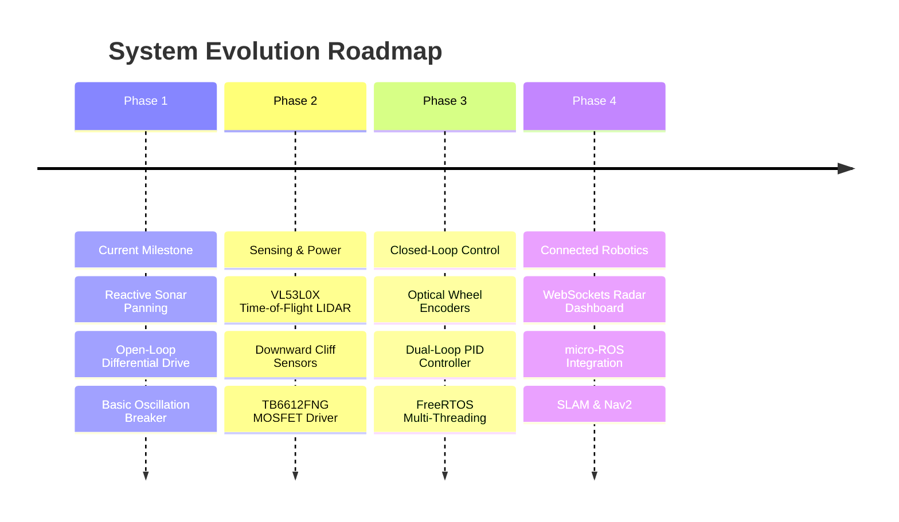
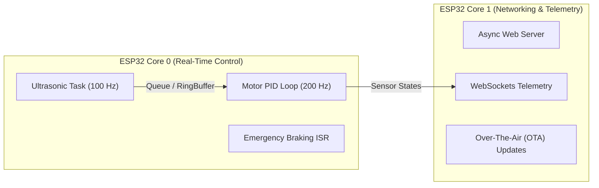

# Architectural Enhancements & Future Roadmap

This document outlines planned hardware and firmware enhancements designed to elevate the **Autonomous Obstacle Avoiding Robot** from a reactive hobby platform to an advanced robotic research testbed.

---

## 1. Roadmap Overview

---

## 2. Sensor Fusion & Perception Enhancements

### 2.1 Optical Time-of-Flight (ToF) Laser Ranging
* **Limitation of Ultrasound:** The HC-SR04 has difficulty detecting soft sound-absorbing materials (curtains, foam, fabric) and surfaces angled $> 45^\circ$ relative to the incident beam.
* **Proposed Upgrade:** Integrate an **STMicroelectronics VL53L0X** or **VL53L1X** laser ranging sensor over I2C.
* **Advantages:**
  * Uses 940 nm VCSEL infrared laser light.
  * Measures distances up to 2 meters with millimetric accuracy independent of target surface reflectance.
  * Much narrower field of view ($25^\circ$), allowing precise obstacle edge localization.

### 2.2 Downward-Facing Cliff / Drop-off Sensors
* **Risk:** The current robot cannot detect descending stairs, table edges, or negative obstacles.
* **Proposed Upgrade:** Install two **TCRT5000 reflective infrared sensor modules** on the front left and front right chassis corners pointing towards the ground.
* **Firmware Integration:** A hardware interrupt (ISR) triggered by sudden loss of surface reflection immediately halts motors and executes an emergency reverse maneuver.

### 2.3 2D Planar LiDAR
* **Proposed Upgrade:** Mount a low-cost $360^\circ$ rotating laser scanner (e.g., RPLiDAR A1M8 or LD19).
* **Benefit:** Eliminates the physical servo panning delay ($280\text{ ms}$) by continuously generating a 360-degree point cloud at 5.5 to 10 Hz.

---

## 3. Drive Electronics & Closed-Loop Motion Control

### 3.1 Transition to MOSFET Motor Drivers (TB6612FNG)
* **The Problem with L298N:** The L298N is based on legacy bipolar Darlington transistors. It exhibits a large internal voltage drop of $1.8\text{V} - 2.5\text{V}$, dissipating substantial heat and reducing motor torque and battery life.
* **Proposed Upgrade:** Replace L298N with the **TB6612FNG** or **DRV8833** dual MOSFET driver.
* **Benefits:**
  * Ultra-low $R_{DS(on)}$ internal resistance ($\sim 0.5\,\Omega$).
  * Negligible thermal dissipation without bulky heatsinks.
  * Substantially higher power efficiency and longer battery runtimes.

### 3.2 Optical Encoders & Dual-Loop PID Control
* **Limitation of Open-Loop Drive:** Battery voltage decay and differences in DC motor internal friction cause the robot to drift slightly from a straight line.
* **Proposed Upgrade:** Mount 20-slot optical encoder discs to each motor shaft paired with optocoupler sensors (LM393).
* **Control Pipeline:**
  * Compute real-time wheel velocity ($\omega$) via hardware pulse accumulation.
  * Implement discrete Proportional-Integral-Derivative (PID) control:
    $$u(t) = K_p e(t) + K_i \int_0^t e(\tau)d\tau + K_d \frac{de(t)}{dt}$$
  * Guarantees perfectly straight cruising and exact 90.0° and 180.0° pivot turns.

---

## 4. Software Architecture & Wireless Telemetry

### 4.1 FreeRTOS Dual-Core Architecture
The ESP32 features a dual-core Tensilica Xtensa processor. Future firmware revisions will partition workloads across cores using FreeRTOS tasks:

### 4.2 WebSockets Real-Time Telemetry Dashboard
* Host an asynchronous HTML5/JavaScript dashboard stored on the ESP32 SPIFFS/LittleFS flash filesystem.
* Stream real-time distance measurements, servo angles, battery voltage, and motor telemetry over WebSockets.
* Provide an interactive polar radar sweep display and a virtual joystick for manual teleoperation override.

### 4.3 micro-ROS & ROS 2 Nav2 Integration
* Run **micro-ROS** natively on the ESP32 via Wi-Fi UDP.
* Publish sensor scans to `/scan` (`sensor_msgs/msg/LaserScan`) and listen to velocity commands on `/cmd_vel` (`geometry_msgs/msg/Twist`).
* Connect directly to a host PC running ROS 2 Humble/Iron to deploy full SLAM (Cartographer or SLAM Toolbox) and Nav2 autonomous path planning.
