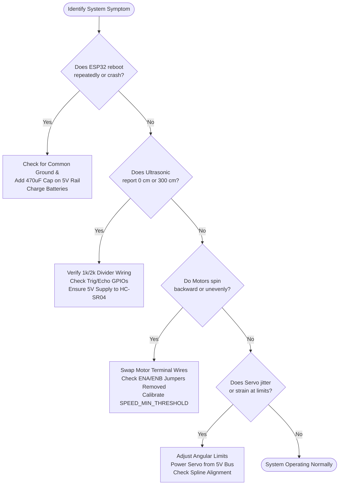

# Hardware & Firmware Troubleshooting Guide

This guide provides diagnostic procedures and corrective actions for common electrical, mechanical, and firmware issues encountered when building and operating the **Autonomous Obstacle Avoiding Robot**.

---

## 1. Quick Diagnostic Flowchart

---

## 2. Systematic Troubleshooting Matrix

| Symptom | Probable Root Causes | Verification Step | Corrective Action |
| :--- | :--- | :--- | :--- |
| **ESP32 reboots continuously** (`Brownout detector was triggered` in Serial Monitor) | 1. Servo or motors pulling heavy current from logic rail. 2. Battery voltage dropping below threshold under motor load. 3. Missing bulk decoupling capacitor. | Measure 5V bus with a multimeter or oscilloscope during motor startup. Observe if voltage dips below 4.5V. | 1. Never power SG90 servo from ESP32 3.3V pin; power strictly from regulated 5V. 2. Solder a $470\,\mu\text{F} \text{ to } 1000\,\mu\text{F}$ capacitor across 5V and GND. 3. Recharge or replace 18650 Li-ion cells. |
| **Ultrasonic reports constant 0 cm or 300 cm** | 1. Missing common ground between HC-SR04 and ESP32. 2. Inverted Trig and Echo wiring. 3. Sensor powered from 3.3V instead of 5V. 4. Miswired voltage divider. | 1. Check continuity between sensor GND and ESP32 GND. 2. Verify Trig is on GPIO 5 and Echo is on GPIO 18. 3. Measure voltage at HC-SR04 VCC pin (must be $\sim 5\text{V}$). | 1. Establish common ground bus. 2. Swap Trig and Echo jumpers. 3. Rewire HC-SR04 VCC to the 5V rail. 4. Recheck the 1kΩ / 2kΩ divider circuit. |
| **Motors do not spin despite code running** | 1. L298N ENA/ENB jumpers still installed or disconnected. 2. PWM speed value below motor stall threshold. 3. Battery switch is OFF or motor power disconnected. | 1. Check if L298N power LED is illuminated. 2. Check if ENA/ENB pins receive PWM signal. 3. Measure voltage across OUT1/OUT2. | 1. Ensure jumpers are removed from ENA/ENB and connected to GPIO 25 and 19. 2. Increase `SPEED_DEFAULT` in `config.h` (e.g., to 200). 3. Verify battery terminal screws are tight. |
| **Robot veers or turns when commanded forward** | 1. DC motor speed mismatch due to gearbox manufacturing tolerances. 2. Differential wheel traction or chassis drag. 3. Caster wheel mechanical friction. | Place robot on blocks (wheels in air) and observe rotational RPM. | Adjust individual motor speeds in `motor_control.h` via `setSpeeds(leftSpeed, rightSpeed)` to trim the drift. |
| **Robot drives backward when commanded forward** | Motor polarity reversed at L298N screw terminals. | Run `motors.moveForward()` and observe wheel rotation direction. | Invert the two wires of the affected motor at the L298N terminal block (`OUT1`/`OUT2` or `OUT3`/`OUT4`). |
| **SG90 Servo jitters or hums loudly** | 1. Servo commanded past its physical internal stops ($0^\circ$ or $180^\circ$). 2. Insufficient current on 5V supply. 3. Long, unshielded signal wire picking up motor EMI. | Disconnect servo arm horn and test unrestricted movement. | 1. Limit sweep angles to $20^\circ$ – $160^\circ$ in `config.h`. 2. Route servo signal wire away from motor power wires. 3. Ensure servo is powered from high-current 5V bus. |
| **ESP32 upload fails** (`Timed out waiting for packet header`) | 1. GPIO strapping pin conflict during boot. 2. Missing automatic reset capacitor on ESP32 board. 3. Wrong COM port or USB cable without data lines. | Check device manager for Silicon Labs CP210x or CH340 serial port. | 1. Hold down the **BOOT** button on the ESP32 while uploading until "Connecting..." appears in the Arduino IDE. 2. Verify charge-only USB cable is not being used. |
| **Robot stuck in corner oscillation loop** | Wall geometry reflects ultrasound at sharp angles or dead-end detected. | Monitor Serial logs at 115200 baud to see obstacle clearance values. | The built-in Loop Breaker triggers after 3 consecutive turns; adjust `MAX_CONSECUTIVE_TURNS` or increase `OBSTACLE_STOP_DISTANCE_CM`. |

---

## 3. Electrical Diagnostic Benchmarks

Use this reference table when validating circuits with a digital multimeter:

| Measurement Testpoint | Expected Nominal Value | Permissible Range | Failure Implication |
| :--- | :---: | :---: | :--- |
| **Battery Terminal Voltage (2S)** | $7.4\text{ V} - 8.4\text{ V}$ | $6.8\text{ V} - 8.4\text{ V}$ | $< 6.5\text{ V}$: Deep battery discharge; recharge cells immediately. |
| **L298N 5V Regulated Output** | $5.00\text{ V}$ | $4.85\text{ V} - 5.15\text{ V}$ | $< 4.7\text{ V}$: 78M05 overloaded or input voltage too low. |
| **ESP32 3V3 Pin** | $3.30\text{ V}$ | $3.20\text{ V} - 3.35\text{ V}$ | $\ne 3.3\text{ V}$: Blown onboard LDO or internal short circuit. |
| **Divider Output (Echo Pin)** | $3.33\text{ V}$ (pulsed) | $3.10\text{ V} - 3.45\text{ V}$ | $> 3.6\text{ V}$: Resistor value incorrect; risk of damaging ESP32 GPIO. |
| **Motor Running Current (Pair)** | $300\text{ mA} - 500\text{ mA}$ | $200\text{ mA} - 1.2\text{ A}$ | $> 1.5\text{ A}$: Mechanical gearbox stall or shorted motor leads. |

