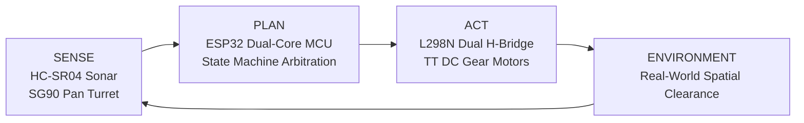

# Engineering Working Principle

This document presents the theoretical foundations, electrical operational mechanics, and algorithmic principles governing the **Autonomous Obstacle Avoiding Robot**.

---

## 1. High-Level System Architecture

The robot is a non-holonomic, two-wheel differential drive mobile robot governed by reactive navigation. Unlike deliberative architectures that require pre-computed global maps, reactive navigation operates as a closed sense-plan-act control loop executed at deterministic microsecond frequencies.



---

## 2. Ultrasonic Distance Measurement Physics

Distance acquisition utilizes acoustic Time-of-Flight (ToF). The HC-SR04 ultrasonic transducer module emits high-frequency sound waves and measures the round-trip propagation time until reflection.

### 2.1 Acoustic Wave Emission & Propagation
1. The ESP32 asserts a $10\,\mu\text{s}$ logic HIGH pulse on the `TRIG` pin.
2. The internal transducer driver circuit excites the ultrasonic transmitter membrane with an 8-cycle burst of $40\,\text{kHz}$ ultrasound.
3. The acoustic wave fronts expand outward in an approximate $15^\circ$ conical dispersion beam at the local speed of sound in air ($v$).
4. Upon encountering an acoustic impedance mismatch (e.g., a solid wall, chair leg, or carton), the incident wave reflects back toward the receiver transducer.
5. The receiver detects the reflected echo, amplifying and filtering the analog signal through an onboard comparator to drive the `ECHO` pin HIGH for the exact duration the wave was in flight.

### 2.2 Mathematical Derivation of Distance

The speed of sound in dry air as a function of ambient temperature ($T$ in $^\circ\text{C}$) is given by:

$$v = 331.3 \times \sqrt{1 + \frac{T}{273.15}}\ \text{m/s}$$

At standard room temperature ($T = 20^\circ\text{C}$):

$$v \approx 331.3 \times \sqrt{1 + \frac{20}{273.15}} \approx 343.2\ \text{m/s} = 0.03432\ \text{cm}/\mu\text{s}$$

Because the acoustic burst travels from the sensor to the obstacle and back to the receiver, the total round-trip distance is $2 \times d$. Therefore:

$$2 \times d = v \times \Delta t$$

$$d = \frac{v \times \Delta t}{2} = \frac{0.03432\ \text{cm}/\mu\text{s} \times \Delta t\ (\mu\text{s})}{2} = \frac{\Delta t}{58.275}\ \text{cm}$$

Where:
* $d$ = One-way target distance in centimeters ($\text{cm}$).
* $\Delta t$ = Echo pulse duration in microseconds ($\mu\text{s}$) captured via `pulseIn()`.
* $58.3$ = Empirical acoustic divisor for standard atmospheric conditions.

---

## 3. Dynamic Servo-Based Spatial Profiling

Mounting the ultrasonic sensor directly to the chassis restricts perception strictly to the current line of travel. To overcome this limitation without increasing component count or cost, the sensor is affixed to a **TowerPro SG90 micro servo**, creating a 1-degree-of-freedom (1-DoF) panning sonar turret.

### 3.1 Spatial Panning Geometry
When an obstacle breaches the safety boundary ($d \le 25\text{ cm}$):
1. **Forward Deceleration:** Both drive motors halt to bring the robot's kinetic energy to zero.
2. **Right Azimuth ($20^\circ$):** The servo pans clockwise to sample the right lateral quadrant. A settling delay of $280\text{ ms}$ allows mechanical inertia to dissipate, eliminating Doppler distortion and vibration-induced noise.
3. **Left Azimuth ($160^\circ$):** The servo pans counter-clockwise across the central meridian to profile the left lateral quadrant.
4. **Spatial Arbitration:** The microcontroller evaluates the scalar clearance measurements ($d_{\text{left}}$ vs $d_{\text{right}}$) to select the heading with greater free space.

```
                  Center (90°)
                       │
             Left      │      Right
            (160°) ↖   │   ↗ (20°)
                     \ │ /
                      [O]  HC-SR04 Turret
                       |
                   [ ROBOT ]
```

---

## 4. Motor Driver Interfacing: L298N Dual H-Bridge

### 4.1 H-Bridge Operation
DC motors reverse direction by switching the polarity of the voltage applied across their two terminals. An H-bridge accomplishes this using four solid-state switching elements (transistors or MOSFETs) configured in an "H" topology:

```
           +V_Motor (7.4V)
              │       │
             [Q1]    [Q3]
              ├──(M)──┤
             [Q2]    [Q4]
              │       │
             GND     GND
```

* **Forward Rotation:** Transistors $Q1$ and $Q4$ conduct; current flows left-to-right through motor $M$.
* **Reverse Rotation:** Transistors $Q3$ and $Q2$ conduct; current flows right-to-left through motor $M$.
* **Brake / Coast:** All switches open (coasting) or lower switches $Q2$ and $Q4$ close simultaneously (dynamic brake).
* **Shoot-Through Protection:** The L298N logic circuit prevents $Q1$ and $Q2$ (or $Q3$ and $Q4$) from conducting simultaneously, which would cause a dead short between $+V_{\text{motor}}$ and GND.

### 4.2 ESP32 LEDC Pulse-Width Modulation (PWM)

The robot controls speed by modulating the effective DC voltage delivered to the motors via the **LEDC peripheral** on the ESP32:

$$V_{\text{effective}} = V_{\text{bus}} \times \left( \frac{\text{Duty}}{255} \right)$$

* **PWM Frequency:** Configured to $1000\text{ Hz}$ ($1\text{ kHz}$). Frequencies below $500\text{ Hz}$ cause audible acoustic motor hum, while frequencies above $10\text{ kHz}$ cause high thermal switching losses in the L298N bipolar transistors.
* **Resolution:** 8-bit ($2^8 = 256$ discrete levels: 0 to 255).
* **Deadband Compensation:** Small DC gear motors require a minimum torque threshold to overcome internal gearbox gear mesh friction and static rotor inertia. A minimum threshold (`SPEED_MIN_THRESHOLD = 120`) guarantees smooth starting torque without motor stall.

---

## 5. Differential Steering Dynamics

The 2WD chassis utilizes differential velocity kinematics. Turning is performed by commanding unequal rotational velocities on the left ($\omega_L$) and right ($\omega_R$) wheels:

* **Pure In-Place Pivot Turn (Zero Turning Radius):**
  $$\omega_L = -\omega_R$$
  Left and right wheels rotate at identical speeds in opposite directions. The instant center of rotation (ICR) coincides exactly with the midpoint of the drive axle, allowing the robot to turn within its own footprint without lateral translation.
* **Straight Forward:**
  $$\omega_L = \omega_R > 0$$

