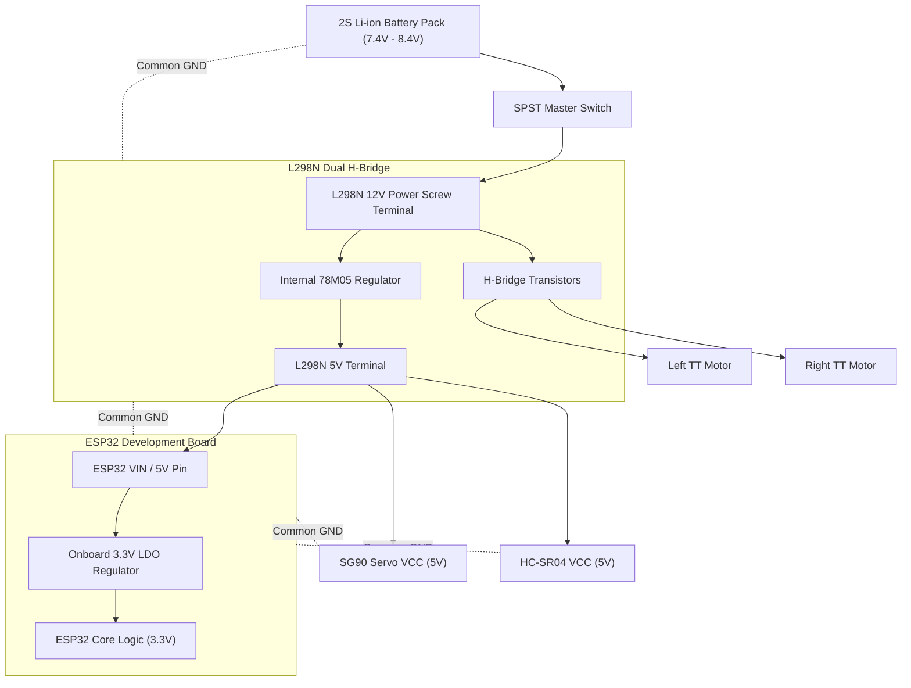

# Hardware Components Specification

This document provides the complete Bill of Materials (BOM) and electrical specifications for the **Autonomous Obstacle Avoiding Robot**.

---

## 1. Bill of Materials (BOM)

| Component | Quantity | Key Specifications | Typical Voltage | Operating Current | Notes |
| :--- | :---: | :--- | :--- | :--- | :--- |
| **ESP32 Dev Module** | 1 | Dual-core Tensilica Xtensa 32-bit LX6, 240 MHz, 520 KB SRAM, Wi-Fi & BLE | 3.3V Logic / 5V VIN | ~80 mA idle, up to 240 mA peak | 30-pin or 38-pin NodeMCU-32S form factor |
| **L298N Motor Driver** | 1 | Dual H-bridge driver IC, integrated heat sink, 5V onboard regulator | 5V – 35V Motor Power, 5V Logic | 2A peak per channel, ~36 mA logic | Jumper enabled for 5V regulator when $V_{in} < 12\text{V}$ |
| **HC-SR04 Ultrasonic Sensor** | 1 | 40 kHz sonar transducer pair, 2 cm to 400 cm range, $15^\circ$ measuring angle | 5.0V DC | 15 mA active | Echo pin produces 5V TTL; requires voltage divider |
| **TowerPro SG90 Servo Motor** | 1 | Micro servo, $180^\circ$ rotation, plastic gears, 1.8 kg·cm torque @ 4.8V | 4.8V – 6.0V DC | 100 mA idle, 500–650 mA stall | Mounts ultrasonic sensor for pan scanning |
| **DC Geared Motors (TT Motor)** | 2 | 1:48 gear ratio, dual shaft, carbon brush | 3.0V – 6.0V DC (nom. 6V) | 70 mA no-load, 250 mA nominal, 800 mA stall | Equipped with 65mm rubber drive wheels |
| **2WD Smart Robot Chassis** | 1 | Acrylic or aluminum baseplate, front caster / ball wheel, hardware standoffs | N/A | N/A | Includes motor brackets and encoder disc slots |
| **Battery Source (2S Li-ion)** | 1 | 2x 18650 3.7V cells in series (7.4V nominal, 8.4V max) with holder | 7.4V – 8.4V | > 2000 mAh capacity, $\ge 2\text{C}$ discharge | Provides independent motor and logic power |
| **Voltage Divider Resistors** | 2 | $1\,\text{k}\Omega$ ($R_1$) and $2\,\text{k}\Omega$ ($R_2$) or $2.2\,\text{k}\Omega$, $0.25\text{W}$ | Up to 5V | $< 2\text{ mA}$ | Drops HC-SR04 5V Echo pulse to safe 3.3V logic |
| **Power Switch (SPST)** | 1 | Rocker or slide switch, rated $\ge 3\text{A}$ at 12V DC | Up to 12V DC | Up to 3A | Master battery cut-off switch |
| **Jumper Wires & Hardware** | 1 pack | M-to-F, F-to-F, M-to-M breadboard/dupont jumpers, M3 standoffs/screws | N/A | N/A | For signal and power distribution |

---

## 2. Component Analysis & Operating Limits

### 2.1 Microcontroller: ESP32 Dev Module
* **Logic Level:** 3.3V CMOS.
* **Maximum GPIO Current:** Absolute maximum sink/source is 40 mA per pin; recommended maximum is 12 mA to guarantee logic levels.
* **Boot Strapping Pins:** GPIO 0, 2, 12, and 15 affect boot mode and flash voltage. These pins are explicitly excluded from high-impedance loads or pull-downs that could prevent normal booting.
* **ADC / Input-Only Pins:** GPIO 34, 35, 36, 39 are input-only and lack internal pull-up/pull-down resistors. All motor and servo outputs are routed to full bi-directional GPIOs (GPIO 5, 13, 19, 25, 26, 27, 32, 33).

### 2.2 Motor Driver: L298N Dual H-Bridge
* **Driver Architecture:** Dual bipolar transistors with internal protection diodes.
* **Internal Voltage Drop:** The L298N suffers from an internal drop of approximately $1.8\text{V} \text{ to } 2.5\text{V}$ across the internal Darlington transistors. Supplying 7.4V – 8.4V delivers approximately 5.5V – 6.5V across the motors, ideal for TT DC gear motors rated for 3V–6V.
* **5V Onboard Regulator:** When the $5\text{V}$ enable jumper is attached, the onboard 78M05 linear regulator provides 5V logic power for internal circuitry and the 5V terminal screw. If the motor supply exceeds 12V, this jumper must be removed to protect the regulator.

### 2.3 Ultrasonic Sensor: HC-SR04
* **Operating Frequency:** 40 kHz ultrasound.
* **Minimum Range:** 2 cm.
* **Maximum Range:** 400 cm (effective reliable range: 250–300 cm in ambient indoor environments).
* **Measuring Angle:** Approximately $15^\circ$ conical beam width.
* **Echo Logic High:** 5.0V. Direct connection to an ESP32 input pin may stress the ESD clamping diodes or degrade the silicon. The 1kΩ / 2kΩ resistive voltage divider reduces this to $3.33\text{V}$.

### 2.4 Pan Turret Servo: SG90 Micro Servo
* **Control Signal:** 50 Hz PWM ($20\text{ ms}$ period) with pulse widths ranging from $500\,\mu\text{s}$ (0°) to $2400\,\mu\text{s}$ (180°).
* **Mechanical Stops:** Avoid commanding the servo to absolute $0^\circ$ or $180^\circ$ extremes to prevent internal mechanical binding and motor burnout. Firmware limits travel between $20^\circ$ and $160^\circ$.
* **Power Demand:** Peak inrush currents during rapid reversals can exceed 600 mA. The servo MUST be powered directly from the 5V rail (regulated from battery), never from the ESP32 3.3V rail.

---

## 3. Power Architecture & Battery Selection

### Safety and Decoupling Recommendations:
1. **Common Ground:** All subsystems (Battery, L298N, ESP32, Servo, Ultrasonic Sensor) **must** share a single unbroken electrical ground.
2. **Brownout Prevention:** Rapid servo repositioning combined with motor startup spikes can cause transient supply dips. Placing a $470\,\mu\text{F} \text{ to } 1000\,\mu\text{F}$ electrolytic capacitor across the 5V rail and GND prevents ESP32 Brownout Detector (BOD) resets.
3. **Motor Noise Suppression:** Solder $0.1\,\mu\text{F}$ (100nF) ceramic capacitors across the terminals of each DC motor to suppress high-frequency EMI generated by mechanical brush arcing.

