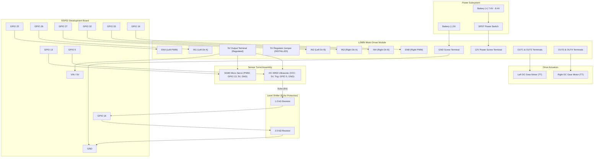

# Wiring Diagram and Electrical Assembly Guide

This guide details the physical wiring, electrical routing, and schematic interconnections for the **Autonomous Obstacle Avoiding Robot**.

---

## 1. Complete Interconnection Schematic

---

## 2. Step-by-Step Wiring Procedure

### Step 1: Power Subsystem & L298N Terminal Block
1. Connect the Positive lead ($+$) from the battery holder through an SPST toggle switch to the **12V terminal** of the L298N.
2. Connect the Negative lead ($-$) from the battery holder to the **GND terminal** of the L298N.
3. Ensure the **5V Regulator Enable Jumper** on the L298N is in place.
4. Run a wire from the L298N **5V Terminal** to a 5V distribution bus (e.g., breadboard rail or power distribution strip).
5. Run a wire from the L298N **GND Terminal** to the common ground rail.

### Step 2: Actuator Connections (DC Gear Motors)
1. Connect the two terminal wires of the **Left Motor** to **OUT1** and **OUT2** screw terminals on the L298N.
2. Connect the two terminal wires of the **Right Motor** to **OUT3** and **OUT4** screw terminals on the L298N.
3. *Phase Check:* If a motor spins backwards when executing the `moveForward()` command, reverse its corresponding leads in the screw terminal.

### Step 3: ESP32 Power and Logic Connections
1. Remove the factory black jumpers from the L298N **ENA** and **ENB** pins (allowing external PWM speed control).
2. Connect the following jumper wires between the ESP32 and L298N:
   * **ESP32 GPIO 25** $\rightarrow$ **L298N ENA**
   * **ESP32 GPIO 26** $\rightarrow$ **L298N IN1**
   * **ESP32 GPIO 27** $\rightarrow$ **L298N IN2**
   * **ESP32 GPIO 32** $\rightarrow$ **L298N IN3**
   * **ESP32 GPIO 33** $\rightarrow$ **L298N IN4**
   * **ESP32 GPIO 19** $\rightarrow$ **L298N ENB**
3. Connect **L298N 5V** $\rightarrow$ **ESP32 VIN pin**.
4. Connect **L298N GND** $\rightarrow$ **ESP32 GND pin**.

### Step 4: SG90 Pan Turret Servo Installation
1. Mount the SG90 servo securely on the front chassis plate facing forward.
2. Connect the servo wiring harness:
   * **Brown / Black Wire:** Common Ground (`GND`).
   * **Red Wire:** Regulated 5V Rail (L298N 5V output).
   * **Orange / Yellow Wire:** **ESP32 GPIO 13** (PWM control).

### Step 5: HC-SR04 Ultrasonic Sensor & Level Shifter
1. Mount the HC-SR04 to the SG90 servo horn using a custom 3D-printed bracket or lightweight sensor bracket.
2. Wire sensor power:
   * **VCC:** Regulated 5V Rail.
   * **GND:** Common Ground (`GND`).
3. Connect trigger line:
   * **TRIG:** **ESP32 GPIO 5**.
4. Assemble the resistive voltage divider for the Echo line on a mini-breadboard or stripboard:
   * Connect **ECHO pin** of HC-SR04 to one leg of the **1.0 kΩ resistor** ($R_1$).
   * Connect the other leg of $R_1$ to both **ESP32 GPIO 18** and one leg of the **2.0 kΩ resistor** ($R_2$).
   * Connect the second leg of $R_2$ to **GND**.

---

## 3. Electromagnetic Interference (EMI) & Power Decoupling

Brushed DC motors produce inductive kickback spikes and high-frequency broadband RF noise from brush commutations. To ensure stable ESP32 operation without erratic watchdog resets:

1. **Snubber / Decoupling Capacitors:** Solder a $100\text{ nF}$ ($0.1\,\mu\text{F}$) monolithic ceramic capacitor across the terminals of each TT DC motor.
2. **Bulk Decoupling:** Place an electrolytic capacitor ($470\,\mu\text{F} \text{ to } 1000\,\mu\text{F}$, $\ge 16\text{V}$) across the 5V power bus near the ESP32 VIN pin to absorb inrush current surges from the SG90 servo motor.
3. **Physical Isolation:** Route logic signal wires (GPIO to L298N inputs, Echo, Trig, Servo PWM) in a separate bundle from high-current battery and motor wiring.
